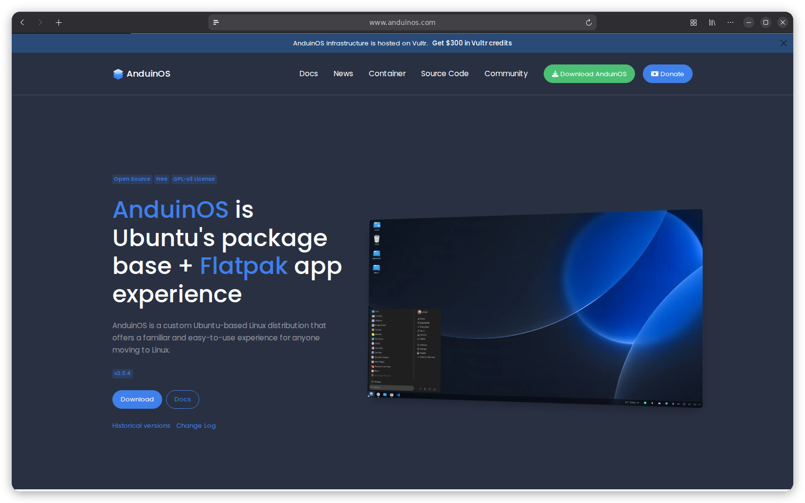

# Aiursoft AnduinOS Home

<a name="anduinos-home"></a>

[](https://github.com/aiursoftweb/AnduinOS-Home/blob/master/LICENSE)
[](https://gitlab.aiursoft.com/aiursoft/anduinoshome/-/pipelines)
[](https://gitlab.aiursoft.com/aiursoft/anduinoshome/-/pipelines)
[](https://s360.aiursoft.com/SupplyChain?tab=projects&project=aiursoft%2Fanduinoshome&scope=baseline&ecosystem=all)
[](https://manhours.aiursoft.com/r/github.com/aiursoftweb/anduinos-home.html)[](https://www.anduinos.com)
[](https://hub.docker.com/r/aiursoft/anduinos-home)

AnduinOS-Home is the home page of AnduinOS, which is an Ubuntu based operating system. It hosts as the home page of the website, including downloading ISO files, read document and join community.



## Overview

### What is AnduinOS Home?

AnduinOS-Home is the home page of AnduinOS, which is an Ubuntu based operating system. It hosts as the home page of the website, including downloading ISO files, read document and join community.

## Try

Try a running AnduinOS-Home [here](https://www.anduinos.com/).

## Install with Docker

Run the installer with the desired port (omit it to choose an available port):

```bash
curl -fsSL https://raw.githubusercontent.com/aiursoftweb/anduinoshome/master/install.sh | sudo bash -s -- 8080
```

Installation starts after three seconds; press Ctrl+C to cancel. Then open `http://localhost:8080`.

## Run manually

Requirements about how to run

1. Install [.NET 10 SDK](http://dot.net/) and [Node.js](https://nodejs.org/).
2. The .NET build automatically runs `npm ci` and `npm run build` to prepare the frontend assets. Node.js and npm must be available when building from source.
3. Execute `dotnet run --project src/Aiursoft.AnduinOSHome/Aiursoft.AnduinOSHome.csproj -- --urls http://localhost:5000` to run the app.
4. Use your browser to view [http://localhost:5000](http://localhost:5000).

## Run in Microsoft Visual Studio

1. Open the `.sln` file in the project path.
2. Press `F5` to run the app.

## Run in Docker

First, install Docker [here](https://docs.docker.com/get-docker/).

Then run the following commands in a Linux shell:

```bash
image=aiursoft/anduinos-home
appName=anduinos-home
sudo docker pull $image
sudo docker run -d --name $appName --restart unless-stopped -p 5000:5000 -v /var/www/$appName:/data $image
```

That will start a web server at `http://localhost:5000` and you can test the app.

The docker image has the following context:

| Properties  | Value                  |
|-------------|------------------------|
| Image       | aiursoft/anduinoshome  |
| Ports       | 5000                   |
| Binary path | /app                   |
| Data path   | /data                  |
| Config path | /data/appsettings.json |

## Usage

### Offline update downloads

`/pro/offline-update-package` reads the public R2 catalog at
`https://offline-update-packages.anduinos.com/offline/catalog.json` (schema version 1).
It shows up to three published batches per release line, suite and architecture,
with direct R2 downloads. No publisher API, database table or storage credentials
are required. The page caches the catalog for five minutes; an unavailable or
invalid catalog displays a temporary-unavailability message instead of an empty release list.
The Offline Updater verifies package signatures and compatibility before installation.

### Automatic hardware content translation

Hardware reviews use the existing `HardwareTranslations` table. New reviews default to English;
write the original review once and Dotlang generates the other site languages in the background.
Device facts (brand, model, SKU, verdicts, URLs, prices) are shared rather than translated.
All 13 review text fields are translated, including capability details, configuration and image credit.

Translation is disabled by default to avoid unexpected AI calls. Configure your own
OpenAI-compatible **chat completions URL** and model through the global settings page,
using the same keys and database-backed settings mechanism as DocsViewer, or via configuration:

```json
{
  "GlobalSettings": {
    "OpenAiInstance": "https://your-ai-service.example/v1/chat/completions",
    "OpenAiLocalizationModel": "your-translation-model",
    "OpenAiApiToken": ""
  }
}
```

The dependency is `Aiursoft.Dotlang.AspNetTranslate` 10.0.70, matching DocsViewer.
The wrapper maps these global settings to Dotlang's internal `Ollama*` options.
Supply credentials through `GlobalSettings__OpenAiApiToken` rather than committing them.
The other settings also support the `GlobalSettings__` environment-variable prefix.
An empty `OpenAiInstance` disables translation; no separate Enabled flag is needed.
Database settings can be changed in the admin UI without restarting the application.
Review content is sent to the configured AI service when translation is enabled.

Saving a device queues translation without delaying the editor. Matching DocsViewer, a scheduled job starts 30 minutes
after application startup and runs every 30 minutes to backfill existing records and retry failed translations.
Administrators can also trigger **Translate hardware content** from `/Jobs` and inspect failures there.
Archived devices and incomplete reviews are skipped. Unchanged, up-to-date translations (including
manual corrections) are preserved. Editing source text increments its revision and automatically
refreshes all outdated languages; the public site shows the source while replacement translations
are pending. A language is saved only after all fields succeed, and results are discarded if the
source changes during translation. Manual edits saved during a translation are not overwritten.

### First-run feedback dashboard

`/OobeFeedback` summarizes the existing anonymous OOBE ratings. Viewing the page and
its navigation entry requires the `ViewOobeFeedbackData` permission. Assign it through
the existing role/permission management UI; existing roles are not silently granted access.

The dashboard offers inclusive UTC date filters, rating/comment search, daily/weekly/monthly
trends, a five-star distribution, and a paginated response list. Counts are submissions,
not unique people. Means and medians are weighted by submission count; variance is the
population variance. Empty periods have no score. All filters apply to both statistics
and the list. The voluntary responses cannot identify users, installations, or OS versions
and should not be treated as a representative survey of all users.

The dashboard only reads the existing ratings table. The public submission API and
its rate limits remain unchanged; no new data collection or database migration is needed.

## Configuration

The application defaults are defined in [`src/Aiursoft.AnduinOSHome/appsettings.json`](src/Aiursoft.AnduinOSHome/appsettings.json). The Docker image initializes `/data/appsettings.json` on its first start and keeps it for later starts; persist `/data`. Override nested values with double-underscore environment variables, such as `Logging__LogLevel__Default`.

```jsonc
{
  "ConnectionStrings": {
    "AllowCache": "True",

    "DbType": "Sqlite",
    "DefaultConnection": "DataSource=app.db;Cache=Shared"

    // sudo docker run -d --name db -e MYSQL_RANDOM_ROOT_PASSWORD=true -e MYSQL_DATABASE=template -e MYSQL_USER=template -e MYSQL_PASSWORD=template_password -p 3306:3306 hub.aiursoft.com/mysql
    //"DbType": "MySql",
    //"DefaultConnection": "Server=localhost;Database=template;Uid=template;Pwd=template_password;"
  },
  "Storage": {
    "Path": "/tmp/data",
    "PublicOrigin": "",
    "RequireDedicatedInlineOrigin": false,
    "AllowArbitraryInlineOnDedicatedOrigin": false,
    "SafeInlineMediaExtensions": ["svg"],
    "SafeInlineSvgSubfolders": ["project-logo"],
    "UploadPolicy": {
      "RequireAuthenticatedUser": false,
      "ReplaceSpacesWithHyphens": false
    }
  },
  "AppSettings": {
    "AuthProvider": "Local", // OIDC or Local
    "DefaultRole": "",
    "PersistsSignIn": false,
    "OIDC": {
      // https://auth.aiursoft.com/application/o/template
      "Authority": "https://auth.aiursoft.com/application/o/template",
      "ClientId": "",
      "ClientSecret": "",
      "RolePropertyName": "groups",
      "UsernamePropertyName": "preferred_username",
      "UserDisplayNamePropertyName": "name",
      "EmailPropertyName": "email",
      "UserIdentityPropertyName": "sub"
    },
    "Local": {
      "AllowRegister": true,
      "AllowWeakPassword": true
    }
  },
  "GlobalSettings": {
    "OpenAiInstance": "",
    "OpenAiLocalizationModel": "",
    "OpenAiApiToken": ""
  },
  "UpgradeScriptEndpoints": [
    "https://raw.githubusercontent.com/Anduin2017/AnduinOS/refs/heads/{Branch}/src/upgrade.sh"
  ],
  "Logging": {
    "LogLevel": {
      "Default": "Information",
      "Microsoft.AspNetCore": "Warning"
    },
    "Clickhouse": {
      "Enabled": false,
      "ConnectionString": "Host=localhost;Protocol=http;Port=8123;User=default;Password=;Database=AspNetCoreLogs",
      "TableName": "AnduinOSHomeLogs"
    }
  },
  "ReleaseArtifacts": {
    "Architectures": {
      "amd64": {
        "IsoUrl": "https://cf.anduinos.com/AnduinOS-2.0.5-amd64.iso",
        "TorrentUrl": "https://cf.anduinos.com/AnduinOS-2.0.5-amd64.torrent",
        "ChecksumUrl": "https://cf.anduinos.com/AnduinOS-2.0.5-amd64.sha256"
      },
      "arm64": {
        "IsoUrl": "https://cf.anduinos.com/AnduinOS-2.0.5-arm64.iso",
        "TorrentUrl": "https://cf.anduinos.com/AnduinOS-2.0.5-arm64.torrent",
        "ChecksumUrl": "https://cf.anduinos.com/AnduinOS-2.0.5-arm64.sha256"
      }
    }
  },
  "AllowedHosts": "*"
}
```

### Shared settings

- `ConnectionStrings` selects the database provider and connection. Prepare the external database before choosing MySQL; keep the SQLite file persistent when using SQLite.
- `Storage` configures local application files. Keep the storage directory persistent and use the documented hostname and upload policies for shared downloads.
- `AppSettings` controls authentication and account synchronization. Choose local accounts or configure the OIDC authority, client and `/signin-oidc` callback; use environment variables for credentials.
- Uncommented `GlobalSettings` entries override the database-backed administration settings. Leave entries commented to use the stored values or application defaults.
- `Logging:LogLevel` controls application and framework verbosity. Configure the optional ClickHouse exporter only when its server and credentials are ready.
- `AllowedHosts` is the ASP.NET Core Host-header allowlist, not a CORS setting.

## How to contribute

There are many ways to contribute to the project: logging bugs, submitting pull requests, reporting issues, and creating suggestions.

Even if you with push rights on the repository, you should create a personal fork and create feature branches there when you need them. This keeps the main repository clean and your workflow cruft out of sight.

We're also interested in your feedback on the future of this project. You can submit a suggestion or feature request through the issue tracker. To make this process more effective, we're asking that these include more information to help define them more clearly.

## License

Licensed under the [MIT License](LICENSE).
